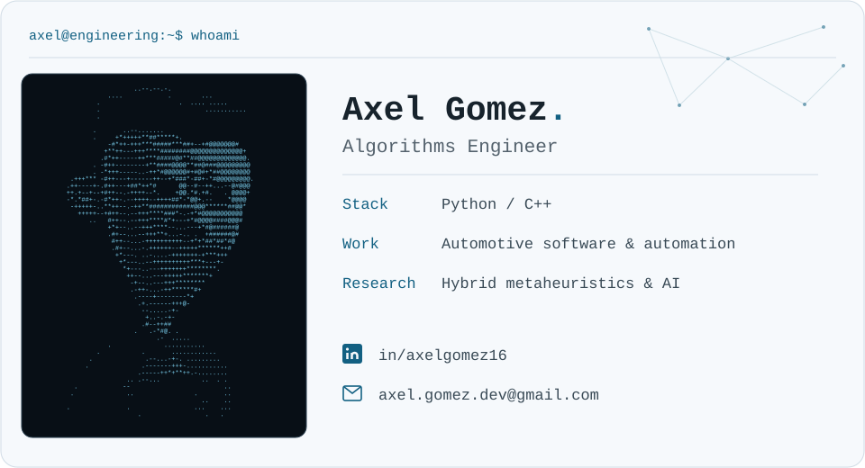

<picture>
  <source media="(prefers-color-scheme: dark)" srcset="assets/profile-dark.svg" />
  
</picture>

# Hi, I'm Axel :)

I build **Python and C++ software** for sensor evaluation, validation automation,
and algorithm integration. I work in automotive R&D at **Aumovio (formerly
Continental R&D)** and am pursuing an **MSc in Computer Science with an AI focus**.

<p align="center">
  <a href="https://axelgomez16.github.io/AxelGomez16/"> Website &amp; CV</a>&nbsp;&nbsp;&nbsp;|&nbsp;&nbsp;&nbsp;
  <a href="https://www.linkedin.com/in/axelgomez16"> LinkedIn</a>&nbsp;&nbsp;&nbsp;|&nbsp;&nbsp;&nbsp;
  <a href="mailto:axel.gomez.dev@gmail.com"> Email</a>
</p>

## Engineering highlights

- **Automotive engineering:** built LiDAR ground-truth evaluation tools and
  dashboards, contributed to C++ camera/radar orchestration, and established
  integration checks to support release decisions.
- **Validation automation:** proposed a radar-model validation pipeline and
  refactored its architecture, reducing turnaround from approximately
  **five working days to 50 minutes**.
- **Postealo:** built and maintain a Python publishing product with LLM-assisted
  editorial preparation and scheduled delivery across five channels, used by
  a paying news organization under a monthly subscription.

Explore my [website](https://axelgomez16.github.io/AxelGomez16/) for detailed experience, research, and my CV. 

## Research in progress

- **Master's thesis:** hybrid genetic algorithms and simulated annealing for
  resource-aware selection of cryptographic algorithms and key lengths in IoT.

- **Research collaboration:** objective-function design and bio-inspired
  optimization for sheep body-weight estimation. 

## Toolbox

| Area | Technologies & methods |
| --- | --- |
| Development | Python, C++, Linux, CMake |
| Evaluate & automate | NumPy, Pandas, SQLite, Dash, Plotly, GitHub Actions |
| Research | Metaheuristic optimization; scikit-learn and PyTorch through academic work |

**Based in Queretaro, Mexico · Open to relocation · English & Spanish**

<details>
  <summary>About this repository</summary>

This repository contains my GitHub profile, role-specific LaTeX CVs,
cover-letter templates, and personal website.

- [CVs and cover letters](documents/)
- [Website and deployment instructions](site/README.md)

With Python and `pdflatex` installed, build a CV from the repository root:

```powershell
python scripts\compile_local_latex.py documents\cv\algorithms-engineer\AxelGomez-Resume.tex
```


</details>